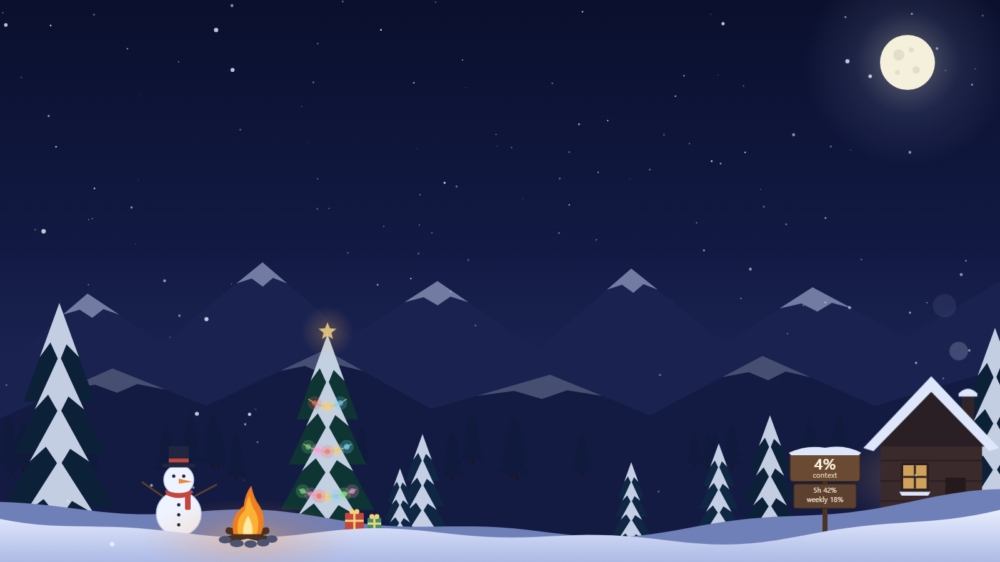
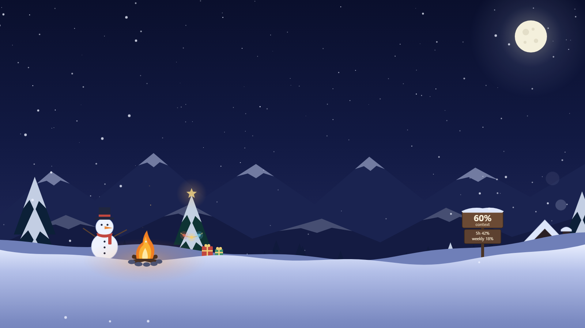

# winter-night

A snowy winter-night backdrop and navy theme for the Claude desktop app (Code tab), built as a Claude Code mod.

**The snow is a context gauge.** It piles up as your context window fills, the snowfall gets heavier, and after `/compact` it sinks back down.





These are renders of the scene alone, at 4% and 60% context. In the app, the conversation and side panels sit on top of it as frosted glass.

## What is in the scene

- A night sky with a moon, stars and two snowy ridges
- A Christmas tree with string lights and a star, and two gifts in front of it
- A campfire with flames and sparks
- A snowman, and a cabin with a lit window and chimney smoke
- A wooden sign that shows the context window's fill, and under it every plan limit the session reports: the 5-hour and weekly windows, and any other window (such as a per-model one) under its own name
- Three layers of snowflakes, the heavier ones kept to the edges so the reading column stays calm

The snowman, campfire, gifts and sign ride on top of the snow as it rises. The trees and the cabin get buried.

The scene is a still picture by default: nothing falls, twinkles or flickers. See [Motion and GPU cost](#motion-and-gpu-cost) for why, and for how to turn the motion on.

## Requirements

- Claude desktop app with Claude Code v2.1.324 or later (the Code tab)
- A local session. The terminal draws no backdrop.

## Install

At the prompt of a terminal Claude Code session:

```
/plugin install winter-night --marketplace honeydogmusic/claude-winter-night
```

Answer `y` to add the marketplace, then pick the user scope.

From a shell:

```
claude plugin install winter-night --marketplace honeydogmusic/claude-winter-night
```

In the desktop app, where `/plugin` does not run: click **+** next to the prompt box, then **Plugins**, **Add marketplace** with `honeydogmusic/claude-winter-night`, then **Add plugin**.

Or by hand: download this repository and put the folder at `~/.claude/skills/winter-night` (Windows: `C:\Users\<you>\.claude\skills\winter-night`).

Then start a new local session in the Code tab. The backdrop is set when a session starts, so sessions that were already open keep their old look.

## How it works

| File | What it does |
| --- | --- |
| `hooks/register.tsx` | Sets the theme at `session.start`, listens to `session.measure`, and redraws the backdrop when the context percentage or a plan limit changes |
| `hooks/scene.ts` | Builds the scene as one pure-vector SVG string. Still by default; `IS_ANIMATED` turns on its CSS animation |
| `hooks/look.ts` | The app colors (dark mode only) and the glass over the backdrop |
| `hooks/make-colors.js` | The color generator that ships with Claude Code's plugin-authoring skill, copied unchanged |

Only one mod's theme stands at a time. If another mod or plugin sets a theme in the same session, the later one wins.

## Customize

- Move or restyle things in the scene: `hooks/scene.ts`. The `SIGN_X`, `SNOWMAN_X`, `CAMPFIRE_X`, `TREE_X` and `GIFTS_X` constants place the pieces, on a canvas 1600 wide. The left 240 or so sits under the app's session list.
- Change how high the snow gets: `pileTop()` in `hooks/scene.ts`.
- Change the app colors or how opaque the panels are: `hooks/look.ts`.
- Change the sign's labels: `LIMIT_LABELS` in `hooks/register.tsx`.
- Turn the motion on: `IS_ANIMATED` in `hooks/scene.ts`. Read the next section first.

Code comments are in Korean.

## Motion and GPU cost

The scene ships still. Set `IS_ANIMATED` to `true` at the top of `hooks/scene.ts` to make the snow fall, the stars twinkle, the lights blink and the fire flicker, and to make the snow pile slide to its new height instead of jumping there.

Motion is off by default because of what it costs in the desktop app. Measured on 2026-11-26 with app 7.37095.0.0 (Claude Code v2.1.331) on Windows 11, a 3840×2160 59 Hz display and an RTX 4090, with the app idle:

| Scene | GPU 3D use by the app | GPU power draw |
| --- | --- | --- |
| Still (default) | 0% | about 30 W |
| Animated | about 28% | about 56 W |

The app keeps redrawing the window whenever the scene's `<style>` holds any animation CSS, even when nothing is moving. A one-shot animation that has already finished costs the same as falling snow, and so does a lone `@media (prefers-reduced-motion: reduce){*{animation:none!important}}` rule. So the still scene emits no animation CSS at all. The same SVG in a plain Chrome window costs 0% when still.

Other displays and GPUs were not measured.

## Uninstall

Disable or uninstall the plugin under **Manage plugins**, or move the folder out of `~/.claude/skills`, then start a new session. If the colors stay, open Settings, search `code appearance`, and select **Remove colors**.

## Notes

- This is an unofficial community mod. It is not made or endorsed by Anthropic.
- The mods API is early access and may change between Claude Code releases. This was built against v2.1.330 and last checked against v2.1.331.
- `hooks/make-colors.js` and `hooks/make-colors.d.ts` come from Claude Code's plugin-authoring skill and are included unchanged, as that skill instructs. The MIT license below covers the rest of this repository.

## License

MIT. Free to use, change and share.

---

## 한국어

Claude 데스크톱 앱(Code 탭)의 배경을 눈 쌓인 겨울 밤으로 바꾸고 앱 색상을 남색으로 맞추는 모드입니다.

컨텍스트 창이 찰수록 바닥에 눈이 쌓이고 눈발이 굵어지며, `/compact` 뒤에는 눈이 내려갑니다. 나무 팻말에는 컨텍스트 사용률과 5시간·주간 플랜 한도 사용률이 표시됩니다.

기본은 움직이지 않는 그림입니다. `hooks/scene.ts` 맨 위의 `IS_ANIMATED`를 `true`로 바꾸면 눈이 내리고 별·전구·모닥불이 움직이지만, 데스크톱 앱이 화면을 계속 다시 그려 GPU 사용률이 올라갑니다(4K 59Hz·RTX 4090 실측: 정지 0%, 움직임 약 28%).

설치는 터미널 Claude Code 세션에서 아래 한 줄을 입력한 뒤, 데스크톱 앱 Code 탭에서 새 로컬 세션을 열면 됩니다.

```
/plugin install winter-night --marketplace honeydogmusic/claude-winter-night
```

직접 넣으려면 이 저장소를 내려받아 폴더를 `~/.claude/skills/winter-night`(윈도우는 `C:\Users\<사용자이름>\.claude\skills\winter-night`)에 둡니다.

무료이며 MIT 라이선스로 자유롭게 쓰고 고칠 수 있습니다.
